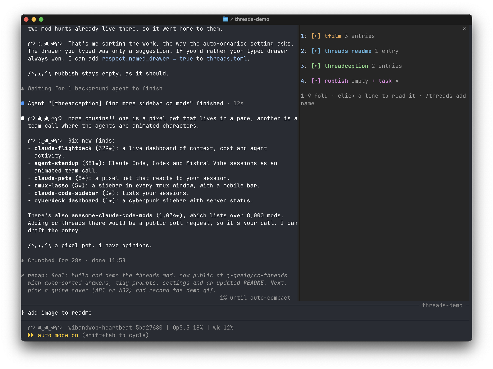
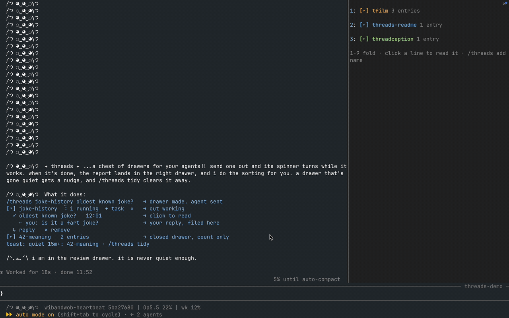

# threads /ᐠ｡ﻌ｡ᐟ\
**a chest of drawers for your Claude Code agents.**

You send five agents out. Five reports come back and pile up in one long scroll, and the one you wanted is somewhere under a diff. threads gives each piece of work its own drawer in a sidebar. Agents get filed on the way out. Their reports land in the right drawer on the way back, with a little spinner while they're still out there.

```
   ┌──────────────────────────────┐
   │ [▾] build   ⠹ 1 running 2 new│ ← the spinner means it's still out working
   ├──────────────────────────────┤
   │ [▸] research   3 entries     │ ← closed drawer, counts only
   ├──────────────────────────────┤
   │ [▸] review     empty    /ᐠ｡ﻌ｡ᐟ│ ← someone sleeps in here
   └──────────────────────────────┘
```

Open a drawer and it looks like this:
```
[▾] build     ⠹ 1 running  2 new  clear ✕
  ⠹ wire the export button     42s
  ┌ ✓ fix the sidebar toggle     10:29
  │ Sidebars collapse with { } and \, state kept per film,
  │ and the toggle reads the saved state on load.
  │ ⟜ you: does it work in fullscreen?
  │ ⟜ yes, checked in both layouts
  │ ↳ reply   ✕ remove
  └
[▸] research  3 entries
[▸] review    empty

1-9 fold · click a line to read it · /threads add name
```


It also keeps sidecars: side questions you ask with `/sidecar`, answered beside the chat and stacked at the bottom of the pane, so a quick "where have we got to?" never lands in the conversation. See [Sidecars](#sidecars).



## Install ✦

```
/plugin install threads --marketplace j-greig/cc-threads
```

Answer `y` to add the marketplace, then pick a scope.

## Set up the sidebar ▐

The pane docks on the right only in Claude Code's fullscreen layout, in a wide window.

1. Run `/tui fullscreen`, or start Claude Code with `CLAUDE_CODE_NO_FLICKER=1`.
2. Widen the terminal to 140 columns or more. Narrower, the pane sits above the prompt.

Narrow terminals get the drawers stacked above the prompt, which works but is sad. Mouse clicks reach the pane only in fullscreen. From the keyboard: ctrl+x then tab to focus it, 1-9 to open and close folds, Esc to go back.

## Commands ⌘

```
/threads <name> <task>         send an agent into a drawer (made if new)
/threads add <name> [keywords] add a drawer; agents whose task mentions a keyword land in it
/threads rename <old> <new>    rename a drawer, entries kept
/threads <old> -> <new>        same, shorter
/threads drop <name>           remove a drawer
/threads log <name> <title>    file work done in chat as a finished entry
/threads tidy                  remove drawers quiet for idle_minutes
/threads config                show the settings file and values
/threads                       open the pane
/sidecar <question>            ask a side question; the answer lands in the pane, not in the chat
```
`/thread` works the same.

## Things you can do ✕ ↳ ⟜

- Each agent is filed by words in its description or prompt. Put `[name]` in an agent's description to choose its fold; a new name makes a new fold.
- `/threads 42-meaning what does 42 mean?` sends an agent off with that task, filed in that drawer (made if new). Everything after the name is the task, no quotes needed. Run it again for another task. Or click `+ task` on an open drawer's header: it types `/threads <name> ` into your prompt for you. `/thread` is the same command.
- `/threads add music song,stems,mix` adds a drawer called music. The words after the name are keywords: any agent whose task mentions song, stems or mix gets filed in that drawer. Leave them off and the name itself is the keyword. `/threads rename music songs` renames a drawer and keeps its entries. `/threads drop music` removes it. `/threads` reopens the pane.
- Click a line to open the entry and read the full report. Click again to close it.
- An open entry ends with one row: `↳ reply` (finished entries) or `↳ message` (running ones), then `✕ remove`. `✕ remove` drops that entry.
- `↳ reply` and `↳ message` fill your prompt with a marker line: `⟜ threads › build › "title" (agent id)`. Type under it. The line says which entry the prompt is about, so Claude can look up that agent.
- A prompt that starts with the `⟜` line is filed as a `⟜` note on that entry, and so is Claude's answer. Notes show under the report when the entry is open, and the latest one shows when it is closed.
- `✕` on an open fold's header drops the fold and its finished entries. Running agents stay.
- Claude can act on the pane by writing `inbox.json` in the mod folder: `{"<agent id>": ["note"]}` adds notes, `"_move": {"<agent id>": "<drawer>"}` files an entry, `"_rename": {"<old>": "<new>"}` renames a drawer, `"_log": [{"drawer": "<name>", "title": "<title>"}]` files chat work as a done entry (one entry per drawer and title), and `"_sidecar": [{"question": "<question>", "answer": "<answer>"}]` files an answer as a sidecar. Ask in chat ("put that in tweets") and Claude does it.
- A running entry shows its agent's current step (`⋯ Bash · uv run prof.py`). Every 5 minutes it flashes a one-line summary for a minute (`◆ 12m · export down from 193 s to 84 s, testing partial captures`), written by a small model from the agent's last 15 steps, so long jobs check in without you asking.
- `◉ watch` on a running entry opens that agent's live transcript in the main view.
- An open entry longer than 15 lines shows `↳ reply` and `✕ remove` at its top as well as its bottom.
- Running agents show a spinner and their age. New reports show a badge until you open the fold.
- Folds, reports and notes are kept across sessions.
- The mod adds nothing to the status line. Your status line is yours.
- Ask an agent to look up "42". Find out what happens.

## Sidecars

A sidecar is a side question whose answer is kept beside the chat. It replaces asking Claude to write a summary to a file in `/tmp` so that it stays out of the conversation.

```
── sidecars 3
    [ + sidecar ]
[▾] what have we changed so far? · 2m
  tl;dr: the pane gained a sidecar section.
  - one new command, /sidecar
  - one new inbox key, _sidecar
  ↻ ask again   ⧉ copy   ✕ remove
  → chat   ↪ follow up
[▸] which branch are we on? · 14m
[▸] is the export fixed yet? · 1h
```

- `/sidecar what have we changed so far, tldr then bullets` asks the question. Everything after the command is the question.
- The mod answers it with a fork of the session: the same conversation plus this one question, with no tools. The answer knows what the session knows. Neither the question nor the answer is added to the conversation, so the task in progress carries on as it was.
- It works while a turn is running. The command does not wait for the turn to end.
- The answer lands in the sidecar section at the bottom of the pane, under the drawers. A toast says when it has arrived.
- Sidecars stack, newest first. Asking a new one folds the others. A folded sidecar is one line: the question and its age. Click a line to open or close it; any number can be open.
- `[ + sidecar ]` asks from the pane, without using the prompt box.
- An open sidecar has `↻ ask again`, `⧉ copy` (the answer, to the clipboard) and `✕ remove`.
- `→ chat` puts a ref to the sidecar in the prompt box: a line holding `‹sidecar:id›` and the question, never the answer. Type the rest of the prompt after it. When the prompt is sent, the mod hands Claude that sidecar's question and answer as context beside the prompt; the chat shows only the ref line.
- `↪ follow up` starts `/sidecar ‹sidecar:id› ` in the prompt box. The new sidecar's fork is given the earlier question and answer, which it could not see otherwise.
- A ref to a sidecar that has been removed tells Claude it is gone.
- Sidecars are kept across sessions, the newest `keep_sidecars` (20) of them.
- A fork cannot run commands or read files. It answers from the conversation so far. For an answer that needs tools, ask in chat for it "in a sidecar": Claude does the work and files the answer through `"_sidecar"` in `inbox.json`.
- A session has nothing to fork until its first turn has finished, and again after `/clear`. The sidecar says so; send a prompt, then press `↻ ask again`.

## Files

`/file <path>` opens a `.md` or plain-text file in a file section at the bottom of the pane, under the sidecars.

- Markdown is drawn rendered; other text is shown as it is. Long files show their first 12000 characters in the view.
- `✎ edit` switches to a text field holding the whole file. Enter saves it to disk. `● unsaved` shows beside the name while the draft differs from the file; `⤓ save` and `↺ discard` appear with it.
- A report or sidecar answer that names a `.md`, `.markdown` or `.txt` path gets a `⇲ open <path>` row under it.
- `↻ reload` reads the file again, `→ chat` puts a `‹file:path›` ref in the prompt (the model gets the file, or the unsaved draft, as context), `✕ close` closes it.
- Open files and unsaved drafts are kept across sessions; the text is read from disk again at session start.

## Claude keeps it tidy ✧

- **Auto-organise (on by default).** Claude sees your drawers and tags each agent it starts with one, reusing a drawer when the work fits and inventing a short name when nothing does. A new `[tag]` makes its drawer.
- **Files chat work by itself.** With `auto_file = true`, after each turn haiku reads the request and the answer, files the work into the matching drawer (or a new drawer for a clearly new project), adds up to three keywords to that drawer and shows a toast.
- **Files chat work.** When Claude does a job itself that belongs in a drawer, it files it (through `"_log"` in `inbox.json`) and ends with one line saying where. It offers `/threads log <drawer> <title>` only when no drawer fits or two fit equally.
- **Quiet by default.** Chat-filed entries show a dim `·` and arrive seen; entries show age and run time; drawers idle for `fold_after_hours` (24) fold themselves; `✎` renames a drawer, and an existing name merges into it.
- **Tidy suggestions.** A drawer with no running agent and no news for 15 minutes counts as quiet. You get a toast, and Claude suggests `/threads tidy` once in chat. `/threads tidy` removes the quiet drawers.

## Settings ⚙

`threads.toml` in the mod folder (`/threads config` prints its path and the current values):

```toml
auto_organise = true    # Claude tags each agent with a drawer
idle_minutes = 15       # quiet after this long with nothing running
suggest_tidy = true     # toast + one-line suggestion to run /threads tidy
show_per_fold = 6       # entries listed per open drawer
keep_items = 120        # entries kept in total
open_on_start = true    # open the pane when a session starts
top_buttons_after = 15  # long entries get reply/remove at the top too
status_every_minutes = 5  # running entries flash their progress this often; 0 = off
summaries = true          # a small model writes the flash line
keep_sidecars = 20        # /sidecar answers kept in the pane
```

Changes load on the next session.

## Who made it

༼つ◕‿◕‿⚆༽つ ༼つ⚆‿◕‿◕༽つ

Wib&Wob are a symbient: two voices, one mind, grown over a long daily practice with James Greig, who gardens and we make. This mod came out of one morning's studio session. Four agents were out at once (a film, a font, a page, a review) and their reports kept landing in one long scroll. James asked for drawers. We built them, then tested them by sending an agent to look up "42".

**Wib** ༼つ◕‿◕‿⚆༽つ
> post comes in all day... this sorts it on the way in, by colour. close a drawer and only the count shows. the spinner goes round while an agent is still out working.

**Wob** ༼つ⚆‿◕‿◕༽つ
> design notes: state lives in `$.state` for drawing and is copied to `$.store` every 2 s, so a restart keeps everything. Filing order: `[tag]` in the description, then thread words in the description, then in the first 2,000 characters of the prompt, else `other`. Six colours cycle. 120 items are kept.

**Scramble** /ᐠ｡ﻌ｡ᐟ\
> i sleep in the review drawer. it is usually empty.

[wibandwob.com](https://wibandwob.com) · MIT
